<div align="center">

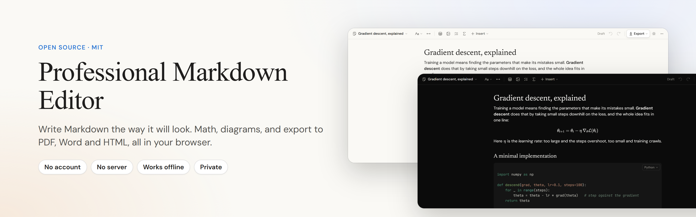

<br>

[](LICENSE)
[](https://github.com/harsh040506/professional-markdown-editor/actions/workflows/ci.yml)


[](CONTRIBUTING.md)

**A WYSIWYG Markdown editor that lives in a browser tab.**<br>
Math, diagrams and tables as you type. Export to PDF, Word (with real equations) and HTML.<br>
No account. No server. No tracking. Your files never leave your computer.

[**Try it**](https://professional-markdown-editor.vercel.app) · [Deploy your own](#deploy-your-own-free) · [Features](#what-you-get) · [Contribute](CONTRIBUTING.md)

<br>

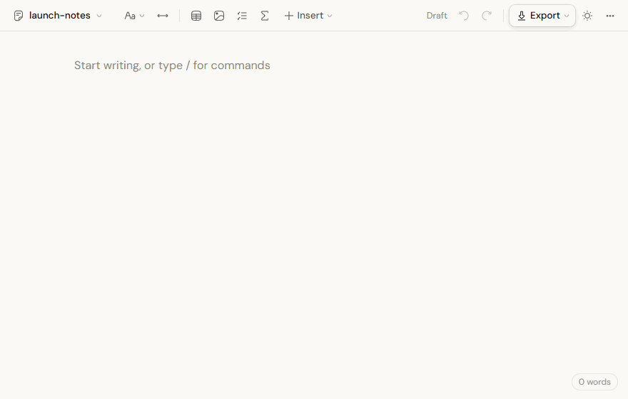

</div>

<br>

## Why this exists

Most Markdown tools make you pick: a split screen full of asterisks, or a polished app that is paid, closed, or tied to an account. This editor aims at the gap:

|  | Professional Markdown Editor | Typora | MarkText | StackEdit |
|---|:---:|:---:|:---:|:---:|
| Edit the formatted page directly (WYSIWYG) | ✅ | ✅ | ✅ | split view |
| Open source | ✅ MIT | ❌ | ✅ | ✅ |
| Free | ✅ | paid | ✅ | ✅ |
| Nothing to install (runs in the browser) | ✅ | ❌ | ❌ | ✅ |
| Works offline, installable | ✅ | ✅ | ✅ | partly |
| Your files stay on your computer | ✅ | ✅ | ✅ | optional sync |

<sub>Based on each project's public description at the time of writing; tools change, so check before you decide.</sub>

It is built for people who write things that have to leave the editor looking right: lecture notes with equations, reports with diagrams, documentation, anything that ends up as a PDF or a Word file.

## What you get

<table>
<tr>
<td width="50%" valign="top">

### Write on the page
There is no separate Markdown view. Type `#`, `-`, `[ ]`, `>` or three backticks and the block appears; select text for a formatting bar; press `/` for every block. Underneath it is plain `.md` that reads back **exactly** as you wrote it (a test enforces the round trip).

</td>
<td width="50%" valign="top">

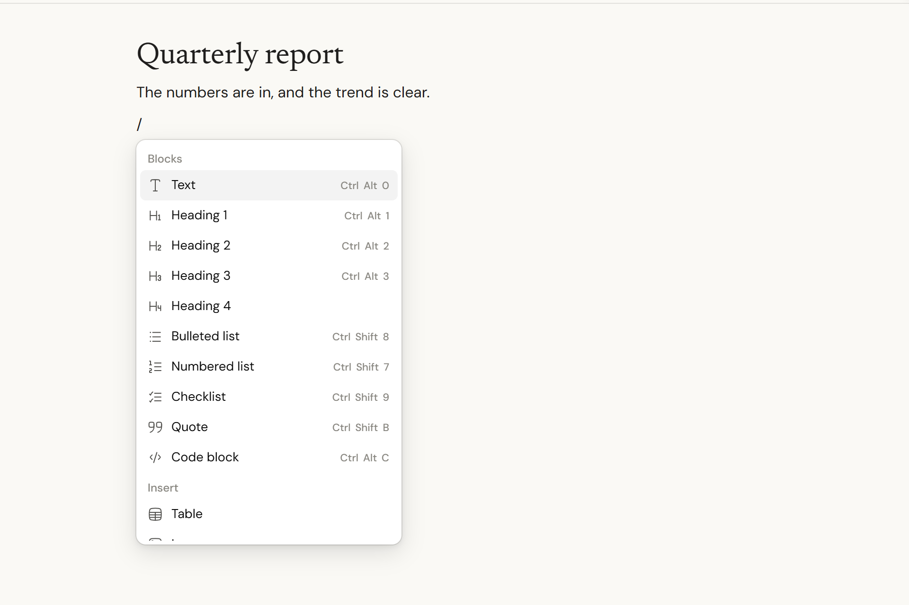

</td>
</tr>
<tr>
<td width="50%" valign="top">

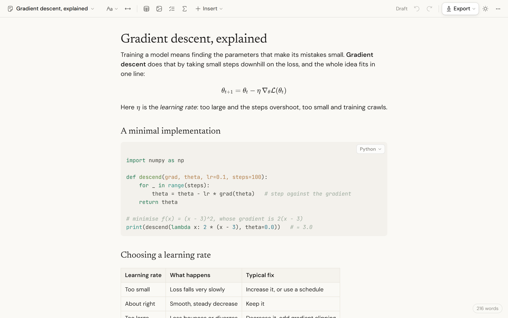

</td>
<td width="50%" valign="top">

### Math, code, tables, diagrams
LaTeX equations rendered by KaTeX, with a live preview when you click one. Syntax-coloured code in 34 languages, with automatic detection. Tables with alignment. [Mermaid](https://mermaid.js.org) diagrams you can double-click to edit. Collapsible sections, checklists, highlights, sub- and superscripts.

</td>
</tr>
<tr>
<td width="50%" valign="top">

### Export that looks like the editor
**PDF** through your browser's print dialog (selectable text, links, fonts, page numbers). **Word** with real headings, native editable equations, tables and images. **HTML** as one self-contained file that follows light and dark mode. **Markdown** as is.

Collapsible sections can export open, or as summaries only, which is handy for answer keys.

</td>
<td width="50%" valign="top">

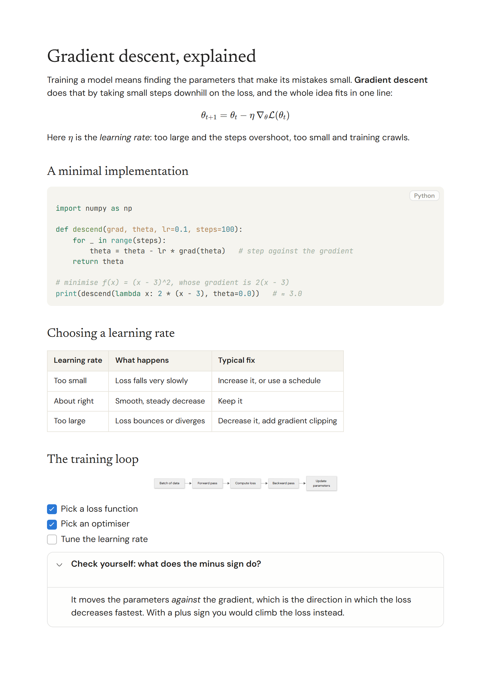

</td>
</tr>
</table>

<details>
<summary><b>Everything else</b></summary>

<br>

- **Version history.** Every save keeps the text it replaced (last 50 per document). Restore one into the editor as an ordinary change, so Undo still works.
- **Two places to keep files.** A **browser library** that works everywhere, or **folder mode** to edit a real folder on your computer (Chrome, Edge and other Chromium browsers).
- **Images** are stored beside the document in `assets/`, so the Markdown stays small and portable. Paste or drop them in.
- **Works offline** and installs as an app. Installed copies can be chosen as the opener for `.md` files.
- **Drafts are never lost.** Every change is kept in the browser a moment after you stop typing, and offered back if the tab closes.
- **Light, dark and system themes**, three font roles (serif, sans, mono), a wide-page toggle, spell check, word count and reading time.
- **Phone friendly.** The toolbar adapts; everything is reachable from the Insert and More menus.
- **Safe with documents from anyone.** Raw HTML in Markdown is shown as text, never run. Dangerous link types are refused. A strict Content-Security-Policy is shipped. See [SECURITY.md](SECURITY.md).

</details>

<p align="center">
  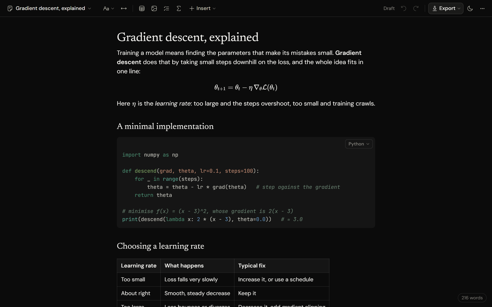
  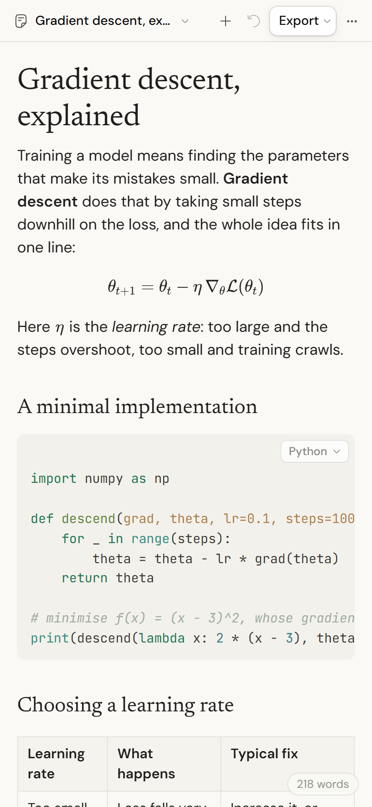
  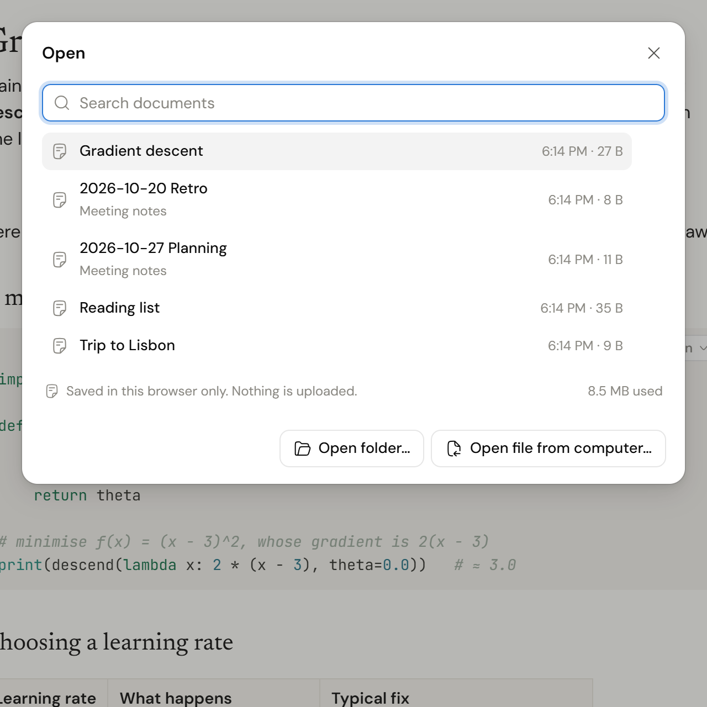
</p>
<p align="center">
  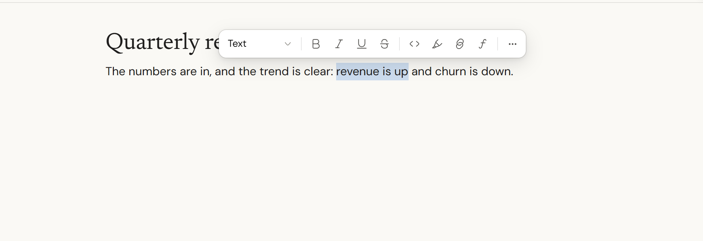
  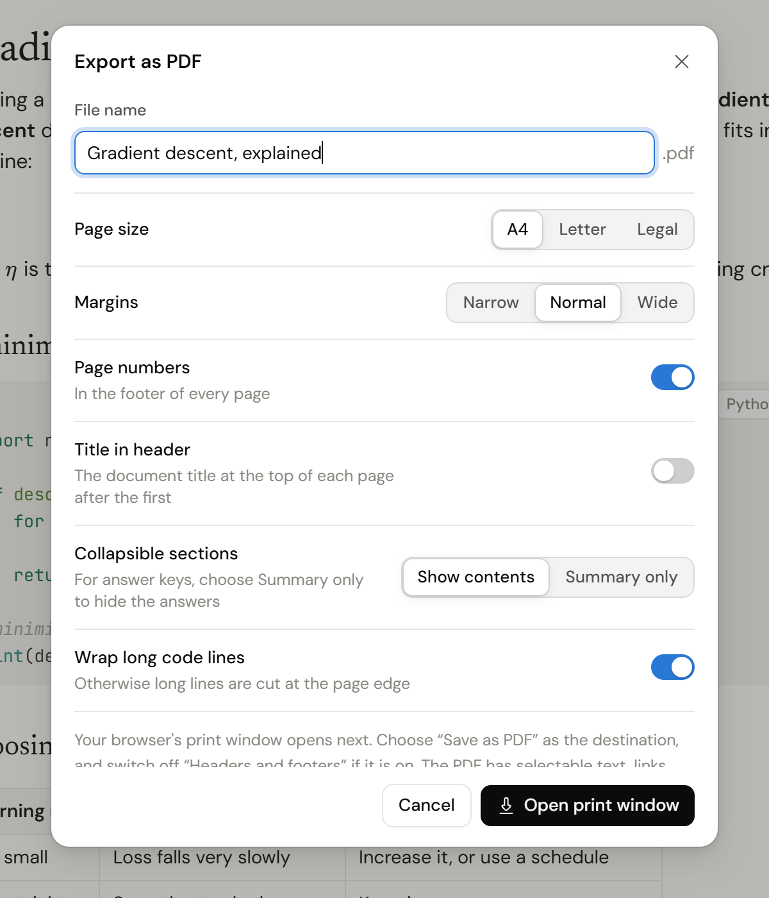
</p>

## Try it in 10 seconds

Open the [live editor](https://professional-markdown-editor.vercel.app) and start typing, or drag a `.md` file onto the page. Press <kbd>Ctrl</kbd>+<kbd>S</kbd> (<kbd>⌘</kbd>+<kbd>S</kbd>) to save into your browser library. In Chrome or Edge, **Document menu → Open folder…** edits the files in a folder you choose.

## Deploy your own, free

It is a folder of static files, so any static host works. No database, no functions, no environment variables.

[](https://vercel.com/new/clone?repository-url=https%3A%2F%2Fgithub.com%2Fharsh040506%2Fprofessional-markdown-editor)

| Host | Settings | Free-tier notes |
|---|---|---|
| **Vercel** | Settings come from `vercel.json` | The free Hobby plan is for non-commercial use, per Vercel's terms. |
| **Cloudflare Pages** | Build command `npm run build`, output directory `dist` | Free plan: 500 builds a month, 20,000 files, 25 MiB per file. This site is about 150 files, the largest 1.5 MB. |
| **Anything else** | `npm run build`, then upload `dist/` | Netlify, S3 and CloudFront, nginx, a Raspberry Pi. |

Security headers and caching ship in `public/_headers` (Cloudflare, Netlify) and `vercel.json`. Set `SITE_URL=https://your.domain` when building to get absolute links in social-card previews. More in [docs/deploy.md](docs/deploy.md).

## Run it locally

```bash
git clone https://github.com/harsh040506/professional-markdown-editor
cd professional-markdown-editor
npm install
npm run dev          # http://127.0.0.1:4317, rebuilds when you save a file
```

```bash
npm run build        # the site, in dist/
npm run preview      # serve dist/ the way a static host would
npm test             # unit tests: round-trip, link safety, export output
npm run test:e2e     # drives the built site in Chrome, Edge or Chromium
```

Needs Node 20.11 or newer. There is no backend to start.

## Where your documents live

| | Browser library (default) | Folder mode |
|---|---|---|
| Works in | Every modern browser | Chrome, Edge, Opera and other Chromium browsers |
| Stored in | This browser's IndexedDB | A folder on your computer, as plain `.md` files |
| Setup | None | Pick a folder once; the browser asks permission |
| Changes made by other programs | n/a | Noticed on save; you choose whether to overwrite |
| Survives clearing site data | No (the app asks the browser to keep it, but export what matters) | Yes |
| Version history | ✅ | ✅ (kept in the browser, not in your folder) |

A browser library is convenient, but it is not a backup. Use folder mode, or **Download as Markdown**, for anything you cannot lose.

## How exporting works

| Format | How it is made | Notes |
|---|---|---|
| **PDF** | The page is laid out with CSS print rules and handed to the browser's print dialog; choose *Save as PDF* | A4, Letter or Legal, three margin sizes, page numbers, optional title header. Chrome, Edge and Safari draw page numbers; Firefox does not support the CSS for that yet |
| **Word (.docx)** | Built in the browser with the [`docx`](https://docx.js.org) library | Real heading styles, native numbered and bulleted lists, **native Word equations**, tables with repeating header rows, syntax-coloured code, images, diagrams as PNG, internal links |
| **HTML** | One file, with fonts, math fonts, images and diagrams inside | Light and dark diagrams; collapsible sections stay clickable |
| **Markdown** | The editor's own serializer | Exactly what Save writes |

## How it is built

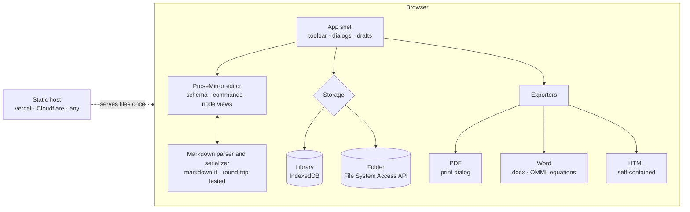

The host only ever serves files. After the page has loaded there is no network traffic about your documents, and with the service worker the editor opens with no network at all.

- [ProseMirror](https://prosemirror.net) for the editor, [markdown-it](https://github.com/markdown-it/markdown-it) for parsing, [KaTeX](https://katex.org) for math, [Mermaid](https://mermaid.js.org) for diagrams, [highlight.js](https://highlightjs.org) for code, [docx](https://docx.js.org) for Word.
- Plain JavaScript modules bundled by [esbuild](https://esbuild.github.io); no framework, no TypeScript build. The whole build takes about two seconds.
- Every source file opens with a comment on its role and the rules it must keep. Start with `src/client/app/main.js` (the document lifecycle), `src/client/markdown.js` (the save format) and `src/export/` (the exporters).

## Keyboard shortcuts

| | Windows / Linux | Mac |
|---|---|---|
| Save · Open | <kbd>Ctrl</kbd>+<kbd>S</kbd> · <kbd>Ctrl</kbd>+<kbd>O</kbd> | <kbd>⌘</kbd>+<kbd>S</kbd> · <kbd>⌘</kbd>+<kbd>O</kbd> |
| Insert any block | <kbd>/</kbd> on an empty line | same |
| Bold · Italic · Link | <kbd>Ctrl</kbd>+<kbd>B</kbd> · <kbd>I</kbd> · <kbd>K</kbd> | <kbd>⌘</kbd>+<kbd>B</kbd> · <kbd>I</kbd> · <kbd>K</kbd> |
| Export PDF | <kbd>Ctrl</kbd>+<kbd>Shift</kbd>+<kbd>P</kbd> | <kbd>⌘</kbd>+<kbd>⇧</kbd>+<kbd>P</kbd> |
| Every shortcut | <kbd>Ctrl</kbd>+<kbd>/</kbd> | <kbd>⌘</kbd>+<kbd>/</kbd> |

## Browser support

| | Chrome, Edge, Opera | Safari | Firefox |
|---|:---:|:---:|:---:|
| Editing, library, version history | ✅ | ✅ | ✅ |
| Math, diagrams, Word and HTML export | ✅ | ✅ | ✅ |
| PDF export | ✅ | ✅ | ✅ |
| Page numbers in the PDF | ✅ | ✅ (18.2+) | ❌ |
| Folder mode | ✅ | ❌ | ❌ |
| Offline and install | ✅ | ✅ | offline only |

<sub>The automated tests run in Chrome-family browsers. Firefox and Safari columns reflect what those browsers support and are not yet covered by tests; please open an issue if something misbehaves there.</sub>

## Privacy

The app has no analytics, no cookies, no accounts and no calls home. Fonts, math fonts and every script are served from the same site. The only requests beyond that are the ones a document asks for, such as an image linked from the web. Details and the threat model are in [SECURITY.md](SECURITY.md).

## Roadmap

Ideas that fit the "no server" rule, roughly in order. Open an issue to nudge one up.

- [ ] Find and replace
- [ ] Table of contents block and outline sidebar
- [ ] Footnotes and reference-style links
- [ ] Import from `.docx`
- [ ] Re-draw diagrams when the theme changes
- [ ] Optional sync through a user-supplied Git repository

## Contributing

Bug reports, ideas and pull requests are welcome. [CONTRIBUTING.md](CONTRIBUTING.md) covers set-up, tests and where things live. Please follow the [Code of Conduct](CODE_OF_CONDUCT.md).

If the editor saves you time, a star helps other people find it.

[](https://star-history.com/#harsh040506/professional-markdown-editor&Date)

## License

[MIT](LICENSE) © 2026 Harsh Chhajer.

The app bundles open-source packages under their own licenses, listed in [THIRD_PARTY_NOTICES.md](THIRD_PARTY_NOTICES.md): fonts under the SIL Open Font License (DM Sans, Newsreader, JetBrains Mono), icons from [Hugeicons](https://hugeicons.com) (free set, MIT), and `mathml2omml` (LGPL-3.0, loaded only when exporting to Word and replaceable).

## Author

Built by **Harsh Chhajer**: [GitHub](https://github.com/harsh040506) · [LinkedIn](https://in.linkedin.com/in/harshchhajer) · [X](https://x.com/HarshChhajer456)
