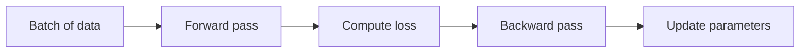

# Gradient descent, explained

Training a model means finding the parameters that make its mistakes small. **Gradient descent** does that by taking small steps downhill on the loss, and the whole idea fits in one line:

$$
\theta_{t+1} = \theta_t - \eta \,\nabla_\theta \mathcal{L}(\theta_t)
$$

Here $\eta$ is the *learning rate*: too large and the steps overshoot, too small and training crawls.

## A minimal implementation

```python
import numpy as np

def descend(grad, theta, lr=0.1, steps=100):
    for _ in range(steps):
        theta = theta - lr * grad(theta)   # step against the gradient
    return theta

# minimise f(x) = (x - 3)^2, whose gradient is 2(x - 3)
print(descend(lambda x: 2 * (x - 3), theta=0.0))   # ≈ 3.0
```

## Choosing a learning rate

| Learning rate | What happens | Typical fix |
|---|---|---|
| Too small | Loss falls very slowly | Increase it, or use a schedule |
| About right | Smooth, steady decrease | Keep it |
| Too large | Loss bounces or diverges | Decrease it, add gradient clipping |

## The training loop



- [x] Pick a loss function
- [x] Pick an optimiser
- [ ] Tune the learning rate

<details><summary>Check yourself: what does the minus sign do?</summary>

It moves the parameters *against* the gradient, which is the direction in which the loss decreases fastest. With a plus sign you would climb the loss instead.
</details>
