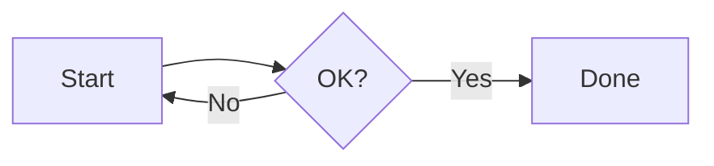

# Everything Document

Intro with **bold**, *italic*, ~~strike~~, `inline code`, ==highlight==, <u>underline</u>, H<sub>2</sub>O, x<sup>2</sup>, a [link](https://example.com) and [anchor](#lists).
Soft line break here.

## Lists

1. First
   - nested bullet with `code`
   - another
     1. deep numbered
2. Second paragraph item

   Continuation paragraph in item.
3. Third

- [x] Done task
- [ ] Open task
  - [ ] Nested task

> A quote with **bold**
>
> - and a list inside

## Math

Inline $\alpha + \beta = \gamma$ and display:

$$\mathbf{h}_t = \tanh\!\left(\begin{bmatrix}0.2\\0.5\end{bmatrix}+\begin{bmatrix}0.16\\0.32\end{bmatrix}\right)$$

$$BP=\begin{cases}1 & c>r\\ e^{1-r/c} & c\le r\end{cases}$$

## Code

```python
import numpy as np
def f(x):  # comment
    return np.exp(x) + "string" + 42
```

```
plain block <unk> text
```

## Table

| Left | Center | Right |
|:---|:---:|---:|
| a | `b` | **c** |
| long text here | $x^2$ | 3 |

## Image and diagram




## Collapsible

<details><summary>Show the answer</summary>

The answer is **42**, because $6\times7=42$.

```python
print(6*7)
```
</details>

---

Last paragraph.
